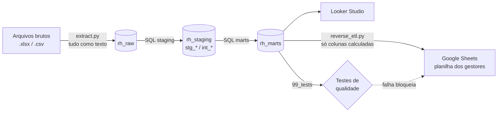

# Case DeMarco: absenteísmo, DSR e ações disciplinares

Solução ponta a ponta para o desafio de Gente & Gestão: ingestão dos arquivos brutos, saneamento, aplicação das regras de negócio (faltas, DSR, custo e régua disciplinar) no **BigQuery**, painel no **Looker Studio** e **Reverse ETL** para a planilha dos gestores no **Google Sheets**, preservando o histórico manual.

**Links da entrega**
- Painel (Looker Studio / Data Studio): https://datastudio.google.com/reporting/52f463dd-8798-4f54-a870-84cdcafe403c
- Planilha dos gestores atualizada pelo Reverse ETL: https://docs.google.com/spreadsheets/d/149LJSDgzEqJDN8pHLvfOnsPfZHE3XE0L9xUnFLH6nCk

---

## 1. Resultado (Jun–Ago/2025)

| Indicador | Valor |
|---|---|
| Desconto total apurado | **R$ 11.083,27** |
| ↳ horas de faltas integrais | R$ 5.437,54 |
| ↳ atrasos e saídas antecipadas (acima da tolerância) | R$ 1.025,89 |
| ↳ DSRs perdidos | R$ 4.619,79 (**42%** do custo) |
| Faltas injustificadas / DSRs perdidos | 30 / 30 |
| Taxa de absenteísmo injustificado | 1,31% das horas previstas |
| Faltas em segunda ou sexta-feira | **27 de 30 (90%)**: o padrão de "emenda" se confirma |
| Ações recomendadas | 7 Suspensões · 2 Advertências · 1 Alinhamento 1-on-1 · 30 sem ação |

Destaques para a diretoria:
- **Operações** (R$ 3,9 mil) e **Logística** (R$ 3,4 mil) concentram 66% do custo.
- **EMP_022** tem só 2 faltas, mas em semanas consecutivas (2 DSRs seguidos). Pela régua isso é **Suspensão**, não Advertência. É exatamente o caso que uma contagem simples de faltas deixaria passar.
- **TI não tem gestor cadastrado**: R$ 1,8 mil de custo e uma suspensão recomendada (EMP_033) sem ninguém responsável na hierarquia.
- 4 das 10 ações recomendadas dependem de **dado estimado** (salário imputado ou escala inferida). Elas aparecem sinalizadas no painel e no mart de qualidade.

---

## 2. Arquitetura



| Camada | Dataset | Conteúdo | Princípio |
|---|---|---|---|
| Raw | `rh_raw` | Arquivos como chegaram, todas as colunas `STRING` + linhagem (`_arquivo_origem`, `_linha_origem`, `_carregado_em`) | Fiel à fonte: nenhum ruído quebra a ingestão |
| Staging | `rh_staging` | `stg_*`: tipagem e padronização. `int_*`: deduplicação, inferências e regras de negócio | Toda limpeza em SQL, auditável |
| Marts | `rh_marts` | Tabelas prontas para consumo (painel e Reverse ETL) | Um grão claro por tabela |

**Um SQL, dois motores.** As queries são escritas em dialeto BigQuery. No modo `--alvo local`, o mesmo SQL é transpilado com `sqlglot` e executado no DuckDB. Isso permite desenvolver e testar sem nuvem e mantém uma única fonte de verdade para as regras de negócio.

---

## 3. Estrutura do repositório

```
case-demarco/
├── pipeline.py                  # ponto de entrada (CLI)
├── src/
│   ├── config.py                # parâmetros (período, tolerância, datasets, planilha)
│   ├── extract.py               # leitura dos arquivos -> raw (+ reparo de encoding)
│   ├── warehouse.py             # BigQuery | DuckDB (mesma interface)
│   ├── transform.py             # executa sql/ em ordem e roda os testes
│   └── reverse_etl.py           # atualização segura da planilha dos gestores
├── sql/
│   ├── 01_staging/              # stg_escalas, stg_colaboradores, stg_ponto
│   ├── 02_intermediate/         # int_colaboradores, int_ponto_diario, int_semanas_dsr
│   ├── 03_marts/                # fct_ponto_diario, mart_absenteismo_colaborador,
│   │                            # rpt_acoes_disciplinares, mart_qualidade_dados
│   └── 99_tests/                # testes de dados (devem retornar 0 linhas)
├── tests/test_reverse_etl.py    # testes unitários (preservação do histórico, encoding)
├── docs/dashboard_looker_studio.md
├── data/
│   ├── raw/                     # arquivos recebidos
│   └── processed/               # marts exportados em CSV + planilha atualizada (modo local)
├── requirements.txt
└── .env.example
```

---

## 4. Como executar

### 4.1 Modo local (sem nuvem, para validar em 1 minuto)

```bash
pip install -r requirements.txt
python pipeline.py --alvo local
python -m pytest tests
```

Gera `data/warehouse.duckdb`, os marts em `data/processed/*.csv` e `data/processed/template_acoes_disciplinares_atualizado.xlsx`, que é o template com as colunas calculadas preenchidas e o histórico intacto.

### 4.2 Produção (BigQuery + Google Sheets)

1. **GCP**: ative as APIs *BigQuery*, *Google Sheets* e *Google Drive*. Crie uma service account com os papéis **BigQuery Data Editor** e **BigQuery Job User** e baixe a chave JSON.
2. **Planilha**: importe `template_acoes_disciplinares.xlsx` para o Google Sheets (Arquivo → Importar) e **compartilhe como Editor com o e-mail da service account**.
3. **Configuração**: copie `.env.example` para `.env` e preencha `GCP_PROJECT_ID`, `GOOGLE_APPLICATION_CREDENTIALS` e `GSHEETS_SPREADSHEET_ID`.
4. **Execução**:
   ```bash
   python pipeline.py --alvo bigquery --etapas reverse_etl --simular   # opcional: mostra o que seria gravado
   python pipeline.py --alvo bigquery
   ```
5. **Painel**: siga [docs/dashboard_looker_studio.md](docs/dashboard_looker_studio.md).

Etapas disponíveis em `--etapas`: `extrair, transformar, testar, exportar, reverse_etl`. Se um teste falhar, o pipeline para **antes** de tocar na planilha dos gestores.

### 4.3 Orquestração em produção

As periodicidades do briefing definem dois agendamentos (ex.: **Cloud Run Job + Cloud Scheduler**, ou duas DAGs no Airflow/Composer):

| Job | Quando | Etapas | Motivo |
|---|---|---|---|
| Diário | 05:00 | `extrair,transformar,testar` | Ponto (D-1) e cadastro chegam diariamente |
| Semanal | segunda, 06:00 | `transformar,testar,reverse_etl` | Os gestores usam a planilha às segundas; ela precisa estar atualizada antes |

`escalas` muda só quando há nova regra contratual, mas a carga completa é barata e mantém o pipeline simples. Para produção, o próximo passo é tornar a carga do ponto **incremental**: append particionado por data de ingestão na raw. A deduplicação em `int_ponto_diario` já resolve reenvios, porque escolhe uma linha por colaborador e dia.

---

## 5. Modelo de dados

| Tabela | Grão | Para quê |
|---|---|---|
| `stg_escalas` | escala | Tipagem e jornada semanal contratual |
| `stg_colaboradores` | linha do cadastro | Salário convertido, datas, duplicatas sinalizadas |
| `stg_ponto` | linha do ponto | Tipagem, código de abono padronizado, duplicatas sinalizadas |
| `int_colaboradores` | colaborador | ID único, escala/salário resolvidos, status do gestor |
| `int_ponto_diario` | colaborador × dia | **Classificação do dia** (`status_dia`) e horas injustificadas |
| `int_semanas_dsr` | colaborador × semana | Perda de DSR e **sequências de semanas consecutivas** |
| `fct_ponto_diario` | colaborador × dia | Fato do painel. O custo do DSR é atribuído à 1ª falta da semana, então qualquer recorte soma o total |
| `mart_absenteismo_colaborador` | colaborador | Custos, régua disciplinar, motivo, sinal de dado estimado |
| `rpt_acoes_disciplinares` | colaborador | Contrato de saída do Reverse ETL (colunas com o nome da planilha) |
| `mart_qualidade_dados` | ocorrência | Cada ruído encontrado, sua severidade e o tratamento aplicado |

---

## 6. Regras de negócio

**Classificação de cada dia** (`int_ponto_diario.status_dia`):

| Status | Condição |
|---|---|
| `DESCANSO` | jornada esperada = 0 |
| `TRABALHO_EM_DESCANSO` | jornada esperada = 0 com horas trabalhadas (hora extra; fora do escopo) |
| `AUSENCIA_ABONADA` | déficit de horas com código de abono |
| `FALTA_INJUSTIFICADA` | dia de trabalho, 0 horas, sem abono |
| `ATRASO_SAIDA_ANTECIPADA` | déficit **> 10 min** sem abono (CLT art. 58 §1º) |
| `PRESENTE` | jornada cumprida ou déficit ≤ 10 min |
| `REGISTRO_INVALIDO` | horas negativas/nulas |

**Fórmulas do financeiro**, aplicadas literalmente:
- `Valor Hora = Salário Mensal / Divisor Contratual`
- `Valor Diária DSR = Valor Hora × (Jornada Semanal / 6)`
- `Desconto Total = (Horas Faltadas Injustificadas × Valor Hora) + (DSRs Perdidos × Valor Diária DSR)`

**Régua disciplinar** (`mart_absenteismo_colaborador.acao_disciplinar_recomendada`), avaliada de cima para baixo:

| Condição | Ação |
|---|---|
| ≥ 4 faltas **ou** ≥ 2 DSRs perdidos em semanas consecutivas | `Suspensão Disciplinar (1 a 3 dias)` |
| 2 a 3 faltas | `Advertência Escrita` |
| 1 falta | `Alinhamento em 1-on-1` |
| 0 faltas | `Sem ação requerida` |

As semanas consecutivas são detectadas com *gaps-and-islands* sobre o índice da semana (`int_semanas_dsr`).

---

## 7. Ruídos encontrados e tratamento

| # | Ruído | Onde | Tratamento |
|---|---|---|---|
| 1 | Salário em 6 formatos: `R$ 2.721,03`, `R$5614`, `2301,08`, `2589.9`, `5.036`, `4200,0` | cadastro | Parser em SQL: vírgula ⇒ padrão BR; `\d{1,3}(\.\d{3})+` ⇒ ponto de milhar (`5.036` = 5036); caso contrário, ponto decimal |
| 2 | Salário `A combinar` / vazio (10 ativos) e `2.4` (abaixo do mínimo) | cadastro | Imputação pela **mediana do cargo** (premissa P5), sinalizada |
| 3 | Datas em `AAAA-MM-DD` e `DD/MM/AAAA` | cadastro | Parser pelos dois padrões |
| 4 | **ID duplicado** `EMP_019` (Gustavo Carvalho × Ana Lima Santos) | cadastro | Mantido o 1º registro (P3) |
| 5 | Escala vazia (EMP_016, EMP_023) | cadastro | Inferida pela jornada do ponto (P4) |
| 6 | Gestor desligado (EMP_005 → EMP_051) e TI sem gestor | cadastro | Sinalizado, sem inventar hierarquia (P6) |
| 7 | **Homônimos** (2× Thiago Pereira, 2× Ana Lima, Rodrigo Souza…) | cadastro | Todos os cruzamentos por ID; gestor exibido como `Nome (ID)` |
| 8 | **Encoding duplo** (`Operações`) em 23 linhas do cadastro e 2 das escalas | cadastro, escalas | Revertido na ingestão e rastreado por linha (P16) |
| 9 | Ponto duplicado: 92 dias do EMP_019 (10 com horas divergentes) | ponto | 1 linha por dia; prevalece a de mais horas (P7) |
| 10 | 7 batidas do EMP_051 **após o desligamento** | ponto | Descartadas (P12) |
| 11 | Horas negativas (`-0.5`, EMP_011) | ponto | Não vira falta; severidade ALTA (P8) |
| 12 | Abono grafado diferente (`ATESTADO MEDICO`) | ponto | Padronizado para `ATESTADO_MEDICO` |
| 13 | `DECLARACAO_HORAS` cobrindo o dia inteiro (EMP_007) | ponto | Abonado e sinalizado para validação (P10) |
| 14 | Déficits de 3–10 min (65 dias) | ponto | Absorvidos pela tolerância da CLT (P2) |
| 15 | `flag_dsr = 1` em dias úteis trabalhados | ponto | Flag ignorado; DSR derivado da semana (P15) |
| 16 | ESC_44H descrita como 8,8h × 5 + 4,4h (= 48,4h) | escalas | Prevalece o contrato de 44h, coerente com o divisor 220 (P11) |
| 17 | Caracteres corrompidos (`Opera��es`, `advert�ncia`) **no template** | planilha | Irrecuperável (U+FFFD) e fora das colunas que o pipeline escreve: preservado como está (P13) |

Todas as ocorrências ficam em `rh_marts.mart_qualidade_dados` (291 linhas: 20 ALTA, 21 MÉDIA, 250 INFO) e na página 4 do painel.

---

## 8. Premissas e decisões

| ID | Premissa | Justificativa |
|---|---|---|
| P1 | Semana do DSR = segunda a domingo; **1 DSR perdido por semana** com ≥ 1 falta injustificada. | Lei 605/49, art. 6º, conforme o briefing. A fórmula `Jornada Semanal / 6` já normaliza escalas com dois dias de descanso (ESC_36H_NOT). |
| P2 | "Horas faltadas injustificadas" = faltas integrais + atrasos/saídas antecipadas acima de 10 min/dia. Ultrapassada a tolerância, desconta-se o déficit inteiro. | O briefing cita explicitamente quem "sai mais cedo sem avisar". CLT art. 58 §1º e Súmula 366 do TST. O painel mostra os componentes separados, então quem preferir só faltas integrais lê o número direto. |
| P3 | ID duplicado: vale o **primeiro registro** do arquivo (EMP_019 = Gustavo Carvalho). | É o registro presente na planilha dos gestores. O segundo (Ana Lima Santos) tem cargo de Produção num departamento de Atendimento e salário abaixo da faixa. Deve ser corrigido na origem. |
| P4 | Escala ausente é inferida pela jornada diária predominante no ponto. | 8,8h ⇒ ESC_44H, 8h ⇒ ESC_40H, 7,2h ⇒ ESC_36H_NOT. Os valores são únicos por escala, então a inferência é determinística. |
| P5 | Salário ausente/inválido: **mediana do mesmo cargo** entre ativos (fallback: departamento). | Sem salário não há custo, e zerar subestimaria o problema. O valor fica marcado como `IMPUTADO_*` e com severidade ALTA para o RH completar o cadastro. |
| P6 | Gestor desligado/ausente **não é reatribuído**. | Inventar hierarquia levaria cobrança à pessoa errada. Aparece como "Sem gestor ativo". |
| P7 | Ponto duplicado com horas divergentes: prevalece o registro com **mais horas**; um abono em qualquer versão é mantido. | Na dúvida gerada por falha de exportação, não penalizar o colaborador. |
| P8 | Horas negativas **não** são tratadas como falta. | Uma batida negativa indica registro (houve marcação), mas não diz quantas horas foram cumpridas. Se o BP confirmar falta, EMP_011 passa de 1-on-1 para Advertência. |
| P9 | Atrasos geram desconto de horas, mas **não** geram perda de DSR nem contam na régua. | O briefing e a régua falam em "faltas". Aplicar punição por atraso exigiria uma política explícita. |
| P10 | Todos os códigos de abono justificam a ausência. `DECLARACAO_HORAS` cobrindo o dia todo é abonada, mas sinalizada. | Declaração de comparecimento normalmente cobre só parte do dia; o BP deve confirmar. |
| P11 | Jornada semanal para o DSR vem do **contrato** (44/40/36h); 12x36 = média de 42h. | A descrição da ESC_44H soma 48,4h, o que contradiz o próprio contrato e o divisor 220. |
| P12 | Batidas fora do vínculo (antes da admissão ou após o desligamento) são descartadas. | Não existe obrigação de jornada sem vínculo. |
| P13 | O Reverse ETL escreve **apenas** `Total_Faltas_Injustificadas`, `Total_DSR_Perdido`, `Acao_Disciplinar_Recomendada` e `Data_Ultimo_Processamento`. | Mesmo colunas de identificação com encoding corrompido não são "corrigidas": a planilha é dos gestores. |
| P14 | Escopo: colaboradores ativos em algum dia do período; trabalho em dia de descanso fica fora do desconto. | Hora extra é outra política. |
| P15 | `flag_dsr` não é usado no cálculo. | Ele contradiz a escala em 3 dias e marca só domingo para quem descansa domingo e segunda. |
| P16 | Correção de encoding é a única transformação feita em Python, na ingestão. | É um problema de decodificação do arquivo e não de conteúdo; cada linha reparada é registrada. |

---

## 9. Reverse ETL: como o histórico manual é protegido

O cabeçalho do template já separa as responsabilidades: colunas **azuis** (A–H) são do sistema e **verdes** (I–K) são dos gestores. O script `src/reverse_etl.py`:

1. Localiza colunas **pelo nome** do cabeçalho; se a planilha for reordenada, nada é gravado no lugar errado. Se faltar coluna, aborta sem gravar.
2. Cruza por **ID**, nunca por nome.
3. Grava **célula a célula** (`batch_update` em 1 chamada) só nas colunas calculadas. A planilha nunca é regravada inteira, então anotações feitas enquanto o job roda sobrevivem.
4. Colaborador novo entra como linha nova, com as colunas manuais em branco. Linha sem correspondência (ex.: desligado) fica intacta.
5. Salva **backup** completo antes de gravar (`data/backups/`).
6. **Relê a planilha** e compara as colunas manuais com o estado anterior. Qualquer divergência gera erro.
7. `--simular` mostra o plano sem gravar.

Validação no modo local: um diff célula a célula entre o template original e o atualizado mostra alterações **apenas nas colunas E–H** (160 células = 40 linhas × 4), sem nenhuma mudança de formatação.

---

## 10. Testes

- **Testes de dados** (`sql/99_tests`, rodam a cada execução): chave única no mart e no fato, domínio da ação, régua revalidada de forma independente, reconciliação de custo fato × mart, parâmetros de cálculo presentes, cobertura de ponto.
- **Testes unitários** (`pytest`): preservação das colunas manuais, colunas reordenadas, linha nova, linha sem correspondência, aborto por coluna ausente, detecção de histórico alterado e reparo de encoding.

---

## 11. Pontos de atenção para o RH

- Completar salário de 10 colaboradores ativos e a escala de 2; corrigir o ID duplicado EMP_019 na origem.
- Definir gestor para o time de **TI** e substituir o gestor desligado da EMP_005.
- O **EMP_001** (cargo: Operador de Produção) aparece como gestor de todos os supervisores e coordenadores. Vale confirmar se o cadastro está correto.
- Antes de aplicar as ações, validar os 3 casos ALTA no ponto: EMP_011 (horas negativas), EMP_007 (declaração de horas no dia todo) e as batidas do EMP_051 após o desligamento.
- O template recebido tem caracteres corrompidos nas colunas de texto. Recomenda-se reexportar a planilha original em UTF-8.
