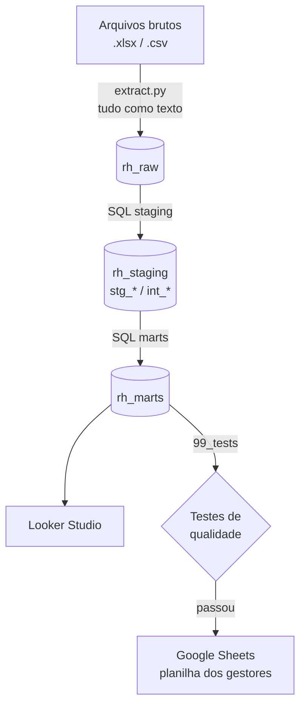

# Case Demarco: absenteísmo, DSR e ações disciplinares

Pipeline que lê os arquivos de RH, trata os problemas dos dados, calcula faltas, DSR perdido, desconto e a ação disciplinar de cada colaborador no BigQuery, alimenta um painel no Looker Studio e atualiza a planilha dos gestores no Google Sheets sem mexer no que eles escreveram à mão.

**Links**
- Painel: https://datastudio.google.com/reporting/52f463dd-8798-4f54-a870-84cdcafe403c
- Planilha dos gestores atualizada: https://docs.google.com/spreadsheets/d/149LJSDgzEqJDN8pHLvfOnsPfZHE3XE0L9xUnFLH6nCk

## 1. Resultado (junho a agosto de 2025)

| Indicador | Valor |
|---|---|
| Desconto total | **R$ 11.083,27** |
| Parte das faltas (dias inteiros) | R$ 5.437,54 |
| Parte dos atrasos e saídas antecipadas | R$ 1.025,89 |
| Parte dos DSRs perdidos | R$ 4.619,79 (42% do total) |
| Faltas injustificadas | 30 |
| DSRs perdidos | 30 |
| Taxa de absenteísmo injustificado | 1,31% das horas previstas |
| Faltas em segunda ou sexta | 27 de 30 (90%) |
| Ações recomendadas | 7 suspensões, 2 advertências, 1 alinhamento, 30 sem ação |

O que mais chamou atenção:
- Operações (R$ 3,9 mil) e Logística (R$ 3,4 mil) somam 66% do desconto.
- A suspeita de "emenda" se confirma: 27 das 30 faltas caíram numa segunda ou sexta.
- A EMP_022 tem só 2 faltas, mas em semanas seguidas, e perdeu 2 DSRs em sequência. Pela régua isso já é suspensão, não advertência.
- O time de TI está sem gestor no cadastro, com R$ 1,8 mil de desconto e uma suspensão recomendada (EMP_033).
- 4 das 10 ações recomendadas usam salário ou escala estimados. No painel elas aparecem marcadas como "Estimado".

## 2. Arquitetura



| Camada | Dataset | O que tem |
|---|---|---|
| Raw | `rh_raw` | Os arquivos como chegaram, tudo como texto, com o nome do arquivo e o número da linha de origem. Assim nenhum dado sujo derruba a carga. |
| Staging | `rh_staging` | `stg_*` tipa e padroniza cada arquivo. `int_*` remove duplicatas, completa o que falta e aplica as regras de negócio. |
| Marts | `rh_marts` | As tabelas finais, usadas pelo painel e pela planilha. |

Todo o SQL está escrito para o BigQuery. Para conseguir testar sem nuvem, o modo local traduz o mesmo SQL para DuckDB com a biblioteca `sqlglot`. A regra de negócio existe num lugar só.

## 3. Estrutura do repositório

```
case-demarco/
├── pipeline.py              comando que roda tudo
├── src/
│   ├── config.py            parâmetros (período, datasets, planilha)
│   ├── extract.py           leitura dos arquivos para a raw
│   ├── warehouse.py         conexão com BigQuery ou DuckDB
│   ├── transform.py         roda os SQL em ordem e os testes
│   └── reverse_etl.py       atualização da planilha dos gestores
├── sql/
│   ├── 01_staging/
│   ├── 02_intermediate/
│   ├── 03_marts/
│   └── 99_tests/            testes de dados (devem voltar 0 linhas)
├── tests/                   testes do Reverse ETL
├── docs/                    documentação do painel
├── data/raw/                arquivos recebidos
└── data/processed/          tabelas finais em CSV e a planilha atualizada (modo local)
```

## 4. Como rodar

**Local, sem nuvem:**

```bash
pip install -r requirements.txt
python pipeline.py --alvo local
python -m pytest tests
```

Gera as tabelas finais em `data/processed/` e uma cópia do template com as colunas calculadas preenchidas.

**BigQuery e Google Sheets:**

1. No Google Cloud, ative as APIs do BigQuery, Google Sheets e Google Drive. Crie uma conta de serviço com os papéis BigQuery Data Editor e BigQuery Job User.
2. Importe o `template_acoes_disciplinares.xlsx` no Google Sheets e compartilhe a planilha como Editor com o e-mail da conta de serviço.
3. Copie `.env.example` para `.env` e preencha o projeto, o caminho da chave e o ID da planilha.
4. Rode `python pipeline.py --alvo bigquery`. Para ver o que seria gravado na planilha antes de gravar: `python pipeline.py --alvo bigquery --etapas reverse_etl --simular`.

As etapas são `extrair, transformar, testar, exportar, reverse_etl`. Se algum teste falhar, o pipeline para antes de chegar na planilha.

**Agendamento.** Pela periodicidade dos arquivos, eu agendaria dois jobs (Cloud Scheduler com Cloud Run, ou Airflow):

| Job | Quando | Etapas | Por quê |
|---|---|---|---|
| Diário | 05:00 | extrair, transformar, testar | Cadastro e ponto chegam todo dia |
| Semanal | segunda, 06:00 | transformar, testar, reverse_etl | Os gestores usam a planilha às segundas |

Hoje cada execução recarrega tudo, o que é simples e suficiente para esse volume. Em produção, o ponto deveria entrar de forma incremental.

## 5. Tabelas

| Tabela | Uma linha por | Para quê |
|---|---|---|
| `stg_escalas` | escala | Jornada semanal e divisor de cada escala |
| `stg_colaboradores` | linha do cadastro | Salário e datas convertidos, duplicatas marcadas |
| `stg_ponto` | linha do ponto | Tipos e código de abono padronizados, duplicatas marcadas |
| `int_colaboradores` | colaborador | Cadastro sem duplicatas, com escala, salário e gestor resolvidos |
| `int_ponto_diario` | colaborador por dia | Status de cada dia e horas a descontar |
| `int_semanas_dsr` | colaborador por semana | DSR perdido e semanas seguidas com perda |
| `fct_ponto_diario` | colaborador por dia | Base dos gráficos por dia e semana. O custo do DSR fica na 1ª falta da semana, para a soma bater em qualquer recorte |
| `mart_absenteismo_colaborador` | colaborador | Custos, régua disciplinar e motivo da ação |
| `rpt_acoes_disciplinares` | colaborador | O que vai para a planilha, com os nomes de coluna dela |
| `mart_qualidade_dados` | problema encontrado | Cada problema dos dados e o que foi feito com ele |

## 6. Regras de negócio

**Status de cada dia** (`int_ponto_diario`). Vale o primeiro que se aplicar, nesta ordem:

| Status | Quando |
|---|---|
| Registro inválido | Horas negativas ou vazias |
| Trabalho em descanso | Dia de folga com horas trabalhadas (hora extra, fora do desconto) |
| Descanso | Dia de folga pela escala |
| Ausência abonada | Faltaram horas, mas o dia tem código de abono |
| Falta injustificada | Dia de trabalho com 0 horas e sem abono |
| Atraso ou saída antecipada | Faltaram mais de 10 minutos, sem abono |
| Presente | Jornada cumprida, ou faltaram até 10 minutos |

**Fórmulas do financeiro**, usadas exatamente como no briefing:
- Valor Hora = Salário Mensal / Divisor Contratual
- Valor Diária DSR = Valor Hora × (Jornada Semanal / 6)
- Desconto Total = (Horas Faltadas Injustificadas × Valor Hora) + (DSRs Perdidos × Valor Diária DSR)

**Régua da Política de Consequências**, com os valores exatos pedidos para a coluna `Acao_Disciplinar_Recomendada`:

| Condição no período | Ação |
|---|---|
| 4 ou mais faltas, ou 2 ou mais DSRs perdidos em semanas seguidas | Suspensão Disciplinar (1 a 3 dias) |
| 2 a 3 faltas | Advertência Escrita |
| 1 falta | Alinhamento em 1-on-1 |
| 0 faltas | Sem ação requerida |

Para achar semanas seguidas com DSR perdido usei a técnica de *gaps and islands* em `int_semanas_dsr`.

## 7. Problemas encontrados nos dados

| # | Problema | Arquivo | O que fiz |
|---|---|---|---|
| 1 | Salário escrito de 6 jeitos: `R$ 2.721,03`, `R$5614`, `2301,08`, `2589.9`, `5.036`, `4200,0` | cadastro | Conversão em SQL: com vírgula, formato brasileiro; ponto seguido de 3 dígitos é milhar (`5.036` = 5036); senão, ponto decimal |
| 2 | Salário `A combinar` ou vazio em 10 ativos, e um `2.4` | cadastro | Mediana do cargo, marcada como estimada (P5) |
| 3 | Datas em `AAAA-MM-DD` e `DD/MM/AAAA` | cadastro | Leitura dos dois formatos |
| 4 | ID duplicado: EMP_019 para Gustavo Carvalho e Ana Lima Santos | cadastro | Fica o 1º registro (P3) |
| 5 | Escala em branco (EMP_016 e EMP_023) | cadastro | Deduzida pela jornada diária no ponto (P4) |
| 6 | Gestor desligado (EMP_005) e TI sem gestor | cadastro | Marcado, sem trocar o gestor (P6) |
| 7 | Homônimos (dois Thiago Pereira, duas Ana Lima) | cadastro | Todo cruzamento por ID; gestor aparece como "Nome (ID)" |
| 8 | Acentos corrompidos (`Operações`) em 23 linhas do cadastro e 2 das escalas | cadastro e escalas | Corrigidos na leitura e registrados por linha (P16) |
| 9 | Dias repetidos no ponto do EMP_019 (92 dias, 10 com horas diferentes) | ponto | Uma linha por dia, vale a de mais horas (P7) |
| 10 | 7 marcações do EMP_051 depois do desligamento | ponto | Descartadas (P12) |
| 11 | Horas negativas (`-0.5`, EMP_011) | ponto | Não viram falta; ficam para validação (P8) |
| 12 | Abono escrito diferente (`ATESTADO MEDICO`) | ponto | Padronizado para `ATESTADO_MEDICO` |
| 13 | `DECLARACAO_HORAS` cobrindo o dia inteiro (EMP_007) | ponto | Abonado e marcado para validação (P10) |
| 14 | Déficits de 3 a 10 minutos (65 dias) | ponto | Não descontados (P2) |
| 15 | `flag_dsr = 1` em dias de trabalho | ponto | Ignorado; o DSR é calculado pela semana (P15) |
| 16 | ESC_44H descrita como 8,8h × 5 + 4,4h, que soma 48,4h | escalas | Vale o contrato de 44h, que bate com o divisor 220 (P11) |
| 17 | Caracteres perdidos no template (`Opera��es`) | planilha | Não há como recuperar e são colunas dos gestores; ficaram como estão (P13) |

Tudo isso está em `rh_marts.mart_qualidade_dados` (291 ocorrências: 20 de severidade alta, 21 média e 250 informativas) e na página 4 do painel.

## 8. Premissas

O briefing pede para registrar as decisões tomadas onde os dados ou as regras não eram claros. Estas são as minhas. Nenhuma delas substitui algo que o briefing definiu: as fórmulas, a régua e os valores da coluna `Acao_Disciplinar_Recomendada` foram usados exatamente como vieram.

| ID | Premissa | Por quê |
|---|---|---|
| P1 | A semana do DSR vai de segunda a domingo, e uma semana com qualquer falta injustificada perde 1 DSR. | É o que diz a Lei 605/49 citada no briefing. A fórmula "Jornada Semanal / 6" já ajusta escalas com duas folgas. |
| P2 | "Horas faltadas injustificadas" inclui os dias de falta e também atrasos e saídas antecipadas acima de 10 minutos. Passou dos 10 minutos, desconta o atraso inteiro. | O briefing cita quem "sai mais cedo sem avisar". Os 10 minutos não vêm do briefing: são a tolerância da CLT (art. 58, §1º, e Súmula 366 do TST). O painel mostra faltas, atrasos e DSR separados, então dá para ver o número sem os atrasos. |
| P3 | Com ID duplicado, vale o primeiro registro do arquivo (EMP_019 = Gustavo Carvalho). | É ele que está na planilha dos gestores. O segundo registro tem cargo de Produção em Atendimento e salário fora da faixa. |
| P4 | Escala em branco é deduzida pela jornada diária mais comum no ponto. | Cada escala tem uma jornada diária diferente (8,8h, 8h, 7,2h), então não há ambiguidade. |
| P5 | Salário vazio, não numérico ou abaixo do salário mínimo de 2025 (R$ 1.518) recebe a mediana do cargo; sem cargo comparável, a do departamento. | Sem salário o desconto daria zero e esconderia o problema. O valor do salário mínimo é premissa minha, só para identificar valores claramente errados como `2.4`. |
| P6 | Gestor desligado ou ausente não é trocado por outro. | Escolher alguém seria cobrar a pessoa errada. Esses casos aparecem como "Sem gestor ativo". |
| P7 | Dia repetido no ponto: vale o registro com mais horas, e um abono em qualquer versão vale para o dia. | Duplicata é erro de exportação, e o colaborador não deveria pagar por ele. |
| P8 | Horas negativas não contam como falta. | Houve marcação, então a pessoa estava lá. Se o RH confirmar a falta, o EMP_011 passa de alinhamento para advertência. |
| P9 | Atraso gera desconto de horas, mas não faz perder DSR nem conta na régua. | A lei e a régua falam em faltas. Punir atraso pediria uma política própria. |
| P10 | Todo código de abono justifica a ausência. `DECLARACAO_HORAS` no dia inteiro é abonada, mas marcada para validação. | Uma declaração de horas costuma cobrir só parte do dia. |
| P11 | A jornada semanal vem do contrato (44h, 40h, 36h); para a 12x36 uso a média de 42h. | A descrição da ESC_44H soma 48,4h, o que contradiz o contrato e o divisor. |
| P12 | Marcações antes da admissão ou depois do desligamento são descartadas. | Sem vínculo não há jornada a cumprir. |
| P13 | O pipeline escreve só em `Total_Faltas_Injustificadas`, `Total_DSR_Perdido`, `Acao_Disciplinar_Recomendada` e `Data_Ultimo_Processamento`. | O resto da planilha é dos gestores, inclusive os nomes com acento quebrado. |
| P14 | Entram no cálculo os colaboradores ativos em algum dia do período. Trabalho em dia de folga não entra no desconto. | Hora extra é outra política. |
| P15 | O campo `flag_dsr` não é usado. | Ele contradiz a escala em vários dias. |
| P16 | A correção de acentos é a única limpeza feita em Python. | É um problema de leitura do arquivo, não do conteúdo. O resto da limpeza está em SQL. |

## 9. Como o Reverse ETL protege o histórico

No template, as colunas azuis (A a H) são do sistema e as verdes (I a K) são dos gestores. O `src/reverse_etl.py`:

1. Encontra as colunas pelo nome do cabeçalho, não pela posição. Se faltar alguma, não grava nada.
2. Cruza os dados pelo ID, nunca pelo nome.
3. Escreve célula por célula, só nas colunas calculadas, numa única chamada. A planilha nunca é regravada inteira.
4. Colaborador novo entra numa linha nova, com as colunas dos gestores em branco. Quem não está mais no pipeline continua na planilha como estava.
5. Salva um backup da planilha antes de gravar.
6. Depois de gravar, lê a planilha de novo e confere se as colunas dos gestores continuam iguais. Se algo mudou, para com erro.

Na prática, comparando a planilha antes e depois, mudaram 160 células (40 linhas × 4 colunas calculadas) e nada mais, nem a formatação.

## 10. Testes

- **Testes de dados** (`sql/99_tests`, rodam a cada execução): chave única, valores válidos para a ação, régua recalculada de forma independente, soma dos custos por dia batendo com o total por colaborador, salário e jornada preenchidos para todos os ativos, e ponto para todos os ativos.
- **Testes do Reverse ETL** (`pytest`): colunas dos gestores preservadas, colunas fora de ordem, colaborador novo, colaborador que saiu, coluna faltando, histórico alterado e correção de acentos.

## 11. Pontos para o RH confirmar

- Salário de 10 colaboradores ativos e escala de 2 estão em branco no cadastro, e o ID EMP_019 está duplicado.
- O time de TI não tem gestor, e o gestor da EMP_005 foi desligado.
- O EMP_001 está cadastrado como Operador de Produção, mas aparece como gestor de supervisores e coordenadores.
- Três casos do ponto precisam de conferência antes de aplicar a ação: as horas negativas do EMP_011, a declaração de horas no dia inteiro do EMP_007 e as marcações do EMP_051 depois do desligamento.
